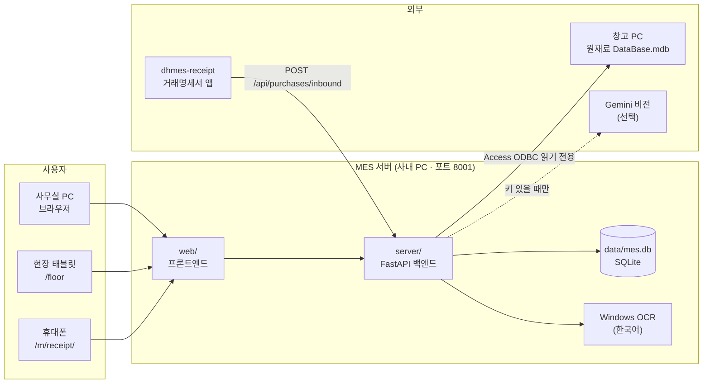

# 대흥공업 MES

> 프레스 공정용 생산관리 시스템 — **v2.3.0** · FastAPI + SQLite · 사내 PC 1대 서버 + 브라우저 접속

원본 MES(v1.19.0)의 백엔드 소스를 받을 수 없어, 실행 중인 화면과 API를 **역분석(REA)** 해 백엔드를 새로 만들었다.
원본 프론트엔드는 그대로 재사용하고, 그 위에 품질관리 · LOT 추적 · 현장 입력 · 거래명세서 연동 같은 **개선 기능**을 더했다.


---

## 목차
- [시스템 구성](#시스템-구성)
- [주요 기능](#주요-기능)
- [폴더 구조](#폴더-구조)
- [실행 방법](#실행-방법)
- [외부 연동](#외부-연동)
- [권한](#권한)
- [변경 이력](#변경-이력)

---

## 시스템 구성



| 구분 | 내용 |
|---|---|
| 백엔드 | FastAPI + uvicorn, 표준 `sqlite3`, `openpyxl` (엑셀) |
| 프론트엔드 | 원본 MES 클라이언트(JS/CSS) 재사용 + 개선 화면 추가, 메뉴 클릭 시 `js/pages/*.js` 동적 로드 |
| 데이터 | `data/mes.db` 한 파일 — 기준정보 테이블은 `meta.py` 정의에서 자동 생성 |
| 인증 | 세션 쿠키(30일), 메뉴 그룹별 권한 레벨 |
| OCR | Windows 10/11 내장 OCR 엔진 — AI · 인터넷 · 추가 설치 없이 동작 |

---

## 주요 기능

> 🆕 = 원본에 없던 개선 기능 · 🔗 = 외부 프로그램 연동

### 🏠 홈
- **대시보드** — 오늘 생산 · 금형 알람 · 작업지시 · 근태 · 불량 요약 (권한 있는 항목만 표시)

### 🏭 생산관리
| 메뉴 | 설명 |
|---|---|
| 작업지시서 | 하루 한 장, 주/야간 설비별 금형 · 제번 편성 (원본 양식 그대로) |
| 납기 · 생산계획 | 납기현황 엑셀 → 결품 수량 계산 → 설비별 주간/야간/특근 칸에 자동 편성, 케파 부족 · 원재료 부족 표시 |
| 생산실적 입력 | 설비 · 제번 · R/L · 시간 · 비가동 입력. 작업지시서 내용으로 미리 채우기 🆕 |
| 작업일보 스캔 (OCR) 🆕 | 종이 작업일보 사진 → OCR로 칸 채움 → 확인 후 저장, 원본 이미지 보관 |
| 현장 입력 (태블릿) 🆕 | 시작 · 비가동(사유별) · 종료 버튼만 누르면 생산실적이 자동으로 쌓임 |
| 생산 보고서 | 일일 · 월간 생산현황, 설비 가동률 · **OEE**, 작업자별 집계, 월간 보고, 연간 누계 |

### ✅ 품질관리
| 메뉴 | 설명 |
|---|---|
| 공정불량 등록 · 불량 집계 | 불량코드별 등록과 기간 집계 |
| 수입검사 · 성적서 🆕 | 코일 입고 시 두께 · 폭 · 외관 검사 → 합격이면 코일 LOT 자동 등록 |
| 초중종물 검사 🆕 | 초품 합격 + 승인이 있어야 생산실적 반영 (**인터락**, 설정에서 켬) |
| 고객불만 · 8D 🆕 | D1~D8 진행 관리, 월별 · 유형별 현황 |
| 계측기 교정관리 🆕 | 검교정 · 자체점검 주기, 다음 예정일 · 지남 알림 |
| 품질문서 🆕 | CP · FMEA · 도면 · 검사기준서 파일과 개정 이력 |
| 품질 월간 리포트 🆕 | 월간 품질 지표 요약 |

### 🔧 금형관리
| 메뉴 | 설명 |
|---|---|
| 타수 · 정비 알람 | 누적 타수 자동 계산, 오버홀 · 세척 · 부품교환 주기별 1차/2차/초과 알람 |
| 금형 위치 · 사진/도면 🆕 | 장착 · 보관 · 사내/외주 수리 · 폐기 이동 기록, 작업지시와 다른 금형 표시, 사진 · 도면 개정 관리 |
| 정비이력 · 수리이력 | 이력 등록, 금형수리이력카드 엑셀(.xlsx/.xls/.zip) 일괄 가져오기 |
| 금형부품 재고 · 입출고 이력 | 입고 · 출고 · 실사 조정, 안전재고 미달 · 품절 표시 |
| 유지비 · 부품 구매단가 🆕 | 생산량 1,000 EA당 금형 유지비, 업체 · 품목 · 재질별 구매단가 비교 |

### 📦 원재료
| 메뉴 | 설명 |
|---|---|
| 원재료 재고 · 입출고 이력 🔗 | 창고 PC 원재료관리 프로그램 DB를 **읽기 전용**으로 조회 (창고 PC가 꺼져 있으면 마지막 자료 표시) |
| 코일 LOT 추적 🆕 | 코일 LOT ↔ 생산실적 ↔ 공정불량 ↔ 고객불만을 한 번에 추적 |
| 소요량 · 수율 · 발주 알림 🆕 | 납기 기준 필요 중량 vs 재고+입고예정 → 발주 필요/주의, 자재 · 제품별 수율 |

### 🧾 구매관리 🔗
| 메뉴 | 설명 |
|---|---|
| 금형부품 명세서 (자동 입고) | 금형부품 업체 명세서 → 금형 · 부품코드를 찾아 **재고 자동 입고**, 애매하면 '확인 필요' |
| 일반 거래명세서 | 그 밖의 업체 명세서를 업체 · 월별로 정리, 사진 보관 |
| 거래명세서 직접 입력 🆕 | 엑셀 · CSV · 스캔 그림 업로드 → 품목별로 금형부품 입고 / 코일 LOT / 기록만 |
| 📱 휴대폰 촬영 (`/m/receipt/`) | 작업자 선택 → 촬영 즉시 업로드 → 백그라운드 분석 → 검수 · 수정 → MES 등록 (중복 경고) |

### 🚚 출하관리
- **출하 준비 · 보류 현황 · 출고 현황** — 생산실적이 출고처별 출하대기 재고로 쌓이고 출고 · 보류 · 조정으로 차감 (R/L 기준, BOX · EA 환산)

### 👥 근태관리
- **월별 근태 · 연차 현황 · 연간 집계** — 기존 근태관리 프로그램과 같은 자료 구조, 원본 양식 그대로 엑셀 출력

### ⚙️ 기준정보 · 설정 · 시스템
- **기준정보** — 제품 · 금형 · 설비(프레스) · 작업자 · 불량코드 · 금형수리유형
- **설정** — 생산 기준(근무 · 휴게), 금형 · SPM 미등록 점검, 근태 설정, 직원 관리
- **시스템** — 데이터 가져오기, 설정 · 백업, 변경 기록, 사용자 · 권한, 메뉴 배치(관리자)

### 📐 생산 지표 계산 방식
```
작업(분)      = 시작 ~ 종료 − 휴게            (자정 넘김 허용)
실적(분)      = 작업 − 비가동
생산량(EA)    = (주간 R/L + 야간 R/L) × 릴수량
이론생산량    = 실적(분) × SPM × Cavity × 효율
OEE           = 시간가동률(실적/작업) × 성능(생산량/이론) × 품질((생산량−불량)/생산량)
```

---

## 폴더 구조

```
MES/
├─ run.bat                 서버 실행 (포트 8001)
├─ server/                 백엔드 (FastAPI)
│  ├─ app.py               진입점 · 라우팅 · 정적 파일 서빙
│  ├─ meta.py              메뉴 · 기준정보 테이블 정의 (/api/meta 단일 출처, 버전)
│  ├─ db.py · auth.py      SQLite 데이터 계층 · 세션 인증 · 권한
│  ├─ tables.py            기준정보/이력 11개 테이블 공통 CRUD
│  ├─ dashboard.py         대시보드 · 홈 집계
│  │
│  ├─ workorders.py        작업지시서
│  ├─ plan.py              납기 · 생산계획 편성
│  ├─ prodcalc.py          생산실적 계산 (작업시간 · 주야 분할 · OEE)
│  ├─ scan.py · floor.py   작업일보 OCR 입력 · 현장 태블릿 입력
│  ├─ reports.py           생산 보고서
│  ├─ quality.py           품질관리 · LOT 추적
│  ├─ molds.py · moldx.py  금형 타수 알람 · 위치/사진/유지비
│  ├─ parts.py             금형부품 재고
│  ├─ repaircards.py       금형수리이력카드 가져오기
│  ├─ rawmat.py · rmx.py   원재료(창고 DB 읽기) · 소요량/수율/발주
│  ├─ invoice.py           거래명세서 직접 입력
│  ├─ receipts.py          dhmes-receipt 연동 (자동 입고)
│  ├─ rcmobile.py          휴대폰 명세서 촬영
│  ├─ ocr.py               Windows OCR 호출
│  ├─ shipping.py          출하관리
│  ├─ attendance.py        근태관리
│  ├─ system.py            사용자 · 설정 · 백업 · 메뉴 배치
│  ├─ xlsx.py              엑셀 내보내기
│  └─ import_orig.py       원본 MES 백업 DB 이전 스크립트
├─ web/                    프론트엔드
│  ├─ index.html           메인 화면
│  ├─ floor.html           현장 태블릿 화면
│  ├─ m_receipt/           휴대폰 명세서 촬영 화면
│  ├─ css/ · js/           공통 스크립트 (core · shared · quality · receipts …)
│  └─ js/pages/            메뉴별 화면
├─ docs/RE_SPEC.md         역분석 명세 · API 계약 · 진행 TODO
└─ data/                   mes.db · 백업 · 스캔 이미지 (git 제외)
```

---

## 실행 방법

### 필요 환경
- Windows 10/11 (OCR · 원재료 연동이 Windows 기능을 사용)
- Python 3.14
- 패키지: `fastapi`, `uvicorn`, `openpyxl` (옛 `.xls` 수리카드를 읽으려면 `xlrd` 추가)
  ```
  pip install fastapi uvicorn openpyxl
  ```

### 서버 켜기
1. `run.bat` 더블클릭 (`MES_PORT=8001` 로 실행). 또는:
   ```
   set MES_PORT=8001
   python server\app.py
   ```
2. 브라우저에서 접속

   | 기기 | 주소 |
   |---|---|
   | 서버 PC | `http://localhost:8001` |
   | 사내 다른 PC | `http://서버IP:8001` |
   | 현장 태블릿 | `http://서버IP:8001/floor` |
   | 휴대폰 촬영 | `http://서버IP:8001/m/receipt/` |

> **주의**
> - `MES_PORT` 없이 `python server\app.py` 만 실행하면 기본값 8000 포트로 뜬다. 이 PC 8000 포트는 다른 프로그램이 쓰고 있을 수 있으므로 8001을 쓴다.
> - 서버 PC의 IP는 공유기가 자동으로 나눠 주므로 바뀔 수 있다. 공유기에서 DHCP 예약으로 고정해 두는 것이 좋다.
> - 데이터 폴더는 환경변수 `MES_DATA_DIR` 로 바꿀 수 있다 (기본 `data/`).

### 최초 로그인
- 아이디 `admin` / 비밀번호 `1234` — 첫 로그인 후 비밀번호 변경을 요구한다.

### 원본 MES 데이터 옮기기 (최초 1회)
서버를 끈 상태에서:
```
python server\import_orig.py <원본 백업 .db 경로>
```
- 기존 DB는 `data/backup/before_import_*.db` 로 먼저 복사해 둔다.
- 사용자 비밀번호는 원본 형식 그대로 옮기고, 첫 로그인 때 새 형식으로 바뀐다.

---

## 외부 연동

| 연동 대상 | 방식 | 설정 위치 |
|---|---|---|
| [dhmes-receipt](https://github.com/schjschj/dhmes-receipt) 거래명세서 앱 | 앱 → `POST /api/purchases/inbound` (Bearer 연동 키) | 구매관리 화면에서 연동 키 발급 · 금형부품 업체 지정 |
| 휴대폰 촬영 분석 | Gemini 비전 키가 있으면 AI, 없으면 Windows OCR | 구매관리 화면 연동 설정 (Gemini API 키 · 모델) |
| 창고 원재료관리 프로그램 | Access ODBC(64비트)로 `DataBase.mdb` 읽기 전용 | 원재료 재고 화면에서 창고 PC 공유폴더 경로 입력 |

---

## 권한

메뉴 그룹(생산관리 · 품질관리 · 금형관리 …)마다 사용자별 레벨을 준다.

| 레벨 | 의미 |
|:-:|---|
| 0 | 메뉴 안 보임 |
| 1 | 보기 |
| 2 | 입력 · 수정 |
| 3 | 삭제 · 관리 |

`admin` 계정은 모든 그룹 3레벨이며, **사용자 · 권한**과 **메뉴 배치**는 관리자만 볼 수 있다.

---

## 변경 이력

| 버전 | 내용 |
|---|---|
| **v2.3.0** | 휴대폰 명세서 촬영을 dhmes-receipt 앱과 같은 구조 · 화면으로 교체 (즉시 업로드 → 백그라운드 분석 → 검수 → 등록) |
| v2.2.2 | 휴대폰 `/m/receipt` 명세서 촬영 추가 (OCR, 자동 회전) |
| v2.2.1 | 금형 위치 칸 정리, 부품 금액을 입고 평균 단가로 계산 |
| v2.2.0 | dhmes-receipt 연동 — 금형부품 명세서 자동 입고, 구매관리 메뉴 신설 |
| v2.1.x | 작업지시 · OCR 작업일보 실적 입력, 현장 태블릿, 금형 위치 · 유지비, 원재료 발주알림 · 수율, 원본 데이터 이전 |
| v2.0.1 | 원본 전체 메뉴 백엔드 재구축 + 품질관리 · LOT 추적 |
| v2.0 | FastAPI 백엔드 골격 + 원본 프론트 재사용 |

자세한 역분석 명세와 남은 작업은 [`docs/RE_SPEC.md`](docs/RE_SPEC.md) 참고.
